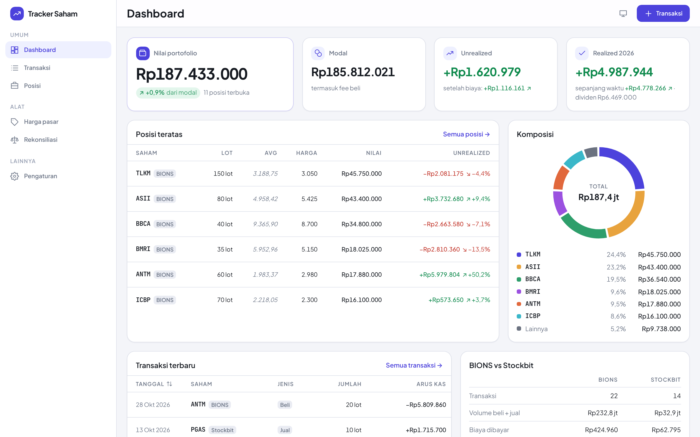

# Tracker Saham

Pencatat transaksi saham IDX untuk portofolio pribadi di beberapa broker — awalnya **BIONS (BNI)** untuk posisi utama dan **Stockbit** untuk transaksi kecil, dan broker lain bisa ditambahkan sendiri. Posisi, harga rata-rata, dan untung/rugi tidak pernah disimpan: semuanya dihitung ulang dari daftar transaksi. Dengan akun, data tersimpan di server dan sinkron antara HP dan laptop.

**Demo:** [stock-tracker-tau-six.vercel.app](https://stock-tracker-tau-six.vercel.app) · Tanpa akun (mode tamu), aplikasi langsung berisi data contoh fiktif yang tersimpan di browser. Buat akun di menu **Akun & sinkron** untuk menyimpan data di server.



## Fitur

- **Transaksi** — beli, jual, dividen tunai, stock split, reverse split, rights issue, dividen saham. Form di drawer, divalidasi Zod, fee & PPh terisi otomatis dari tarif broker tapi tetap bisa diubah sesuai konfirmasi.
- **Posisi per broker** — BBCA di BIONS dan BBCA di Stockbit adalah dua baris terpisah. Filter per broker yang dipakai, baris total yang hanya menjumlahkan.
- **Broker sendiri** — tambah broker (Ajaib, IPOT, …) beserta tarifnya di Pengaturan. Mengubah tarif tidak mengubah fee transaksi lama.
- **Unrealized "setelah biaya"** — toggle untuk mengurangi fee jual + PPh final yang pasti dibayar saat menjual.
- **Dashboard** — nilai portofolio, modal, unrealized, realized tahun berjalan, komposisi, posisi teratas, transaksi terbaru.
- **Pemakaian broker** — berapa yang tergerus biaya di tiap broker yang dipakai, dan apakah trade kecil di broker kedua sebenarnya untung.
- **Akun & sinkron** — masuk dengan email + kata sandi; data tamu di browser bisa dipindahkan ke akun dengan satu klik.
- **Rekonsiliasi** — sandingkan harga rata-rata hitungan aplikasi dengan angka di aplikasi broker.
- **Harga pasar manual** — dengan penanda kapan terakhir diperbarui.
- Mode gelap tiga keadaan (terang, gelap, ikut sistem), kerapatan tabel, tampilan kartu di HP.

## Menjalankan

Butuh Node.js 20+.

```bash
npm install
npm run dev        # http://localhost:5173 — mode tamu (localStorage) jalan tanpa server
npm run test:run   # Vitest sekali jalan (npm test untuk mode watch)
npm run lint
npm run build
```

Untuk mode akun secara lokal, butuh Postgres:

```bash
cp .env.example .env          # isi DATABASE_URL dan JWT_SECRET
npm run migrasi               # buat tabel
npm run dev:server            # API di :3001 (Vite mem-proxy /api ke sini)
DATABASE_URL_TEST=postgres://… npm run test:run   # ikut menjalankan test integrasi API
```

### Deploy (Vercel + Neon)

Frontend dan API ada di satu proyek Vercel. API adalah aplikasi Express yang dibundel menjadi satu Vercel Function (`api/index.js`), Postgres dari Neon lewat Vercel Marketplace.

1. Vercel → proyek → **Storage** → buat database **Neon** dan hubungkan ke proyek (mengisi `DATABASE_URL` dan `DATABASE_URL_UNPOOLED`).
2. **Settings → Environment Variables** → tambah `JWT_SECRET` (string acak ≥ 32 karakter).
3. Redeploy. Build command `npm run build:vercel` (diatur di `vercel.json`) menjalankan migrasi, membundel API, lalu membangun frontend.

## Alasan di balik arsitektur

**Transaksi adalah satu-satunya sumber kebenaran.** Aplikasi ini tidak menyimpan "posisi saat ini". Setiap kali layar butuh posisi, `hitungPosisi()` membangunnya ulang dari seluruh transaksi, diurutkan berdasarkan tanggal lalu `dibuatPada`. Konsekuensinya, salah input bisa diperbaiki dengan mengubah satu transaksi tanpa merusak histori, dan tidak ada dua sumber data yang bisa saling bertentangan. Biayanya hanya komputasi — dan ribuan transaksi selesai dalam hitungan milidetik. Uang selalu bilangan bulat rupiah dan jumlah selalu lembar (bukan lot), supaya corporate action dan pembulatan tidak menghasilkan pecahan.

**Fee disimpan, bukan dihitung ulang saat ditampilkan.** Tarif broker di `config/brokers.ts` hanya dipakai untuk mengisi nilai awal di form. Yang tersimpan di transaksi adalah angka yang benar-benar didebit. Kalau fee dihitung ulang dari config setiap kali ditampilkan, maka begitu broker mengubah tarif dan config diperbarui, seluruh harga rata-rata dan realized P/L historis ikut berubah diam-diam — tanpa error, angkanya saja yang salah. Saat mengedit transaksi lama pun, fee tersimpan dipertahankan; menghitung ulang harus diklik secara eksplisit.

**Posisi dipisah per broker.** Kunci posisi adalah `(ticker, broker)`. Rata-rata gabungan BBCA di BIONS dan di Stockbit adalah angka yang tidak cocok dengan aplikasi mana pun dan tidak menjawab pertanyaan apa pun. Dengan pemisahan ini, setiap baris bisa langsung disandingkan dengan angka di aplikasi brokernya (halaman Rekonsiliasi), dan perbandingan BIONS vs Stockbit jadi mungkin. Yang digabung hanya total portofolio — penjumlahan, tidak pernah perata-rataan.

**Penyimpanan dibuat sebagai interface.** Komponen tidak tahu data disimpan di mana: mereka memakai hook, hook memakai repository (`TransactionRepository`, `BrokerRepository`, `PriceRepository`), dan implementasinya dipilih hanya di `main.tsx` — `localStorage` untuk mode tamu, REST API untuk akun. Semua method-nya `async` sejak hari pertama walaupun `localStorage` sinkron. Hasilnya terbukti saat backend ditambahkan: tidak ada satu pun komponen yang perlu tahu soal `fetch`.

**Server memakai ulang domain yang sama.** Server tidak menghitung posisi (posisi tetap dihitung di klien), tetapi setiap perubahan transaksi dijalankan di dalam transaksi database lalu diperiksa dengan `periksaRiwayat()` — fungsi domain yang sama dengan yang dipakai form, beserta skema Zod yang sama. Kalau sebuah perubahan membuat riwayat tidak konsisten (misalnya menghapus pembelian yang menopang penjualan), database di-*rollback*. Satu implementasi aturan, dua tempat penegakan.

**Broker adalah data, bukan config.** Daftar broker milik pengguna; id-nya dibentuk dari nama dan tidak pernah berubah karena transaksi merujuk ke id itu. Di database, foreign key `(user_id, broker)` memastikan transaksi hanya bisa memakai broker yang terdaftar dan broker yang masih dipakai tidak bisa dihapus. Lihat [ADR 001](docs/decisions/001-broker-dinamis.md) dan [ADR 002](docs/decisions/002-backend-vercel-neon.md).

## Struktur

```
src/
├── config/      daftar broker awal — tidak mengimpor apa pun
├── domain/      tipe, skema Zod, rumus (fees, positions, portfolio, money, brokers) — hanya boleh impor config/
├── data/        repository localStorage & API, sesi, preferensi, data contoh
├── hooks/       Context + hook: sesi, transaksi, broker, harga, preferensi, posisi
├── components/  komponen aplikasi + ui/ (primitif tanpa logika bisnis)
└── pages/       Dashboard, Transaksi, Posisi, Harga, Rekonsiliasi, Akun, Pengaturan
server/          Express + Postgres (SQL lewat node-postgres): auth, rute, migrasi, test integrasi
api/index.js     Vercel Function — mengekspor ulang server yang sudah dibundel
```

Aturan lapisan dipaksakan oleh ESLint (`no-restricted-imports`, `no-restricted-globals`): `domain/` yang mengimpor React, `localStorage`, `fetch`, atau `data/` gagal di `npm run lint`, dan `server/` hanya boleh mengimpor `src/domain` dan `src/config`.

Dokumen rancangan lengkap ada di [`docs/`](docs/): [ARCHITECTURE](docs/ARCHITECTURE.md), [ROADMAP](docs/ROADMAP.md), [DESIGN](docs/DESIGN.md), dan catatan sprint di [catatan sprint](docs/decisions/sprint-mvp.md).

## Testing

Test difokuskan ke tempat uang dihitung. `src/domain/__tests__/` memuat 15 kasus uji wajib dari [ARCHITECTURE §6](docs/ARCHITECTURE.md), termasuk:

- **#12** input tidak urut tanggal menghasilkan posisi yang identik,
- **#13** beli & jual di tanggal yang sama diurutkan oleh `dibuatPada`, bukan urutan array,
- **#14** jual melebihi kepemilikan melempar error, bukan menghasilkan lembar negatif,
- **#10** fee minimum (`Math.max`) dibuktikan dengan tarif ber-minimum, walaupun broker awal tidak punya fee minimum.

Angka harapan di tiap test dihitung manual dan ditulis di komentarnya.

`server/__tests__/api.test.ts` adalah test integrasi terhadap Postgres sungguhan (dilewati tanpa `DATABASE_URL_TEST`): sesi & cookie, pemisahan data antarpengguna, tanggal tetap `YYYY-MM-DD`, `dibuatPada` naik ketat, penolakan jual melebihi kepemilikan, dan foreign key broker.

## Keterbatasan & langkah berikutnya

- **Tarif broker belum diverifikasi** dengan konfirmasi transaksi asli (fase 0 dilewati). Tarif jual diasumsikan sudah termasuk PPh final 0,1%. Kasus uji #15 dengan data asli masih `it.todo`; yang ada sekarang versi data fiktif.
- **Sinkron sederhana.** Data akun dimuat ulang saat aplikasi dibuka atau tab kembali aktif; tidak ada pembaruan *real-time*, dan perubahan bersamaan dari dua perangkat memakai "yang terakhir menang".
- **Belum ada lupa kata sandi / verifikasi email.**
- **Harga pasar diisi manual.** `PriceRepository.getAll()` adalah satu-satunya pintu baca, jadi menggantinya dengan API harga cukup di satu tempat.
- **Belum ada grafik tren nilai portofolio** — butuh histori harga yang belum ada di model data.
- **Data contoh fiktif.** Ticker nyata dipakai agar mudah dibaca, tetapi transaksi, harga, dividen, dan stock split ICBP di dalamnya adalah karangan.
- Input harga rata-rata di halaman Rekonsiliasi tidak disimpan.
- Keputusan kecil lain dan hal yang disederhanakan selama sprint tercatat di [`docs/decisions/sprint-mvp.md`](docs/decisions/sprint-mvp.md).

## Stack

React 19 · TypeScript (strict) · Vite · Tailwind CSS v4 · Zod · Recharts · Vitest · ESLint + Prettier. Server: Express 5 · Postgres (Neon) via node-postgres · bcrypt + JWT di cookie httpOnly · Vercel Functions. Font: Plus Jakarta Sans (typeface Indonesia) dan JetBrains Mono untuk kode ticker.
